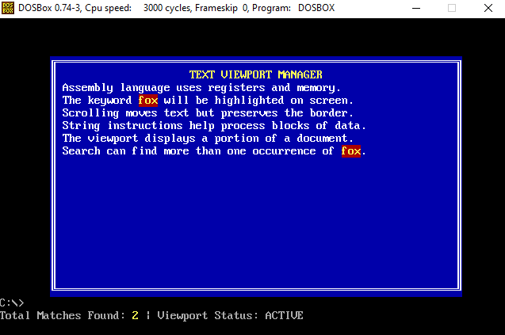
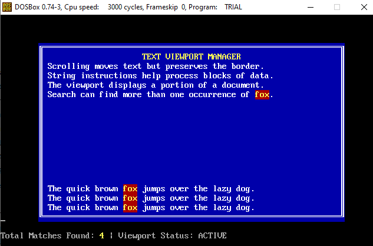

# COAL - Assignment 3

**Name:** Mahnoor Shariq
**Roll No:** 25L-0595

## Q2: Text Viewport Manager

### Description
This is an 8086 assembly program that manages a text viewport in DOS text mode (80x25, video memory at 0xB800). It draws a bordered window on screen, prints lines of text inside it, searches the text for a keyword and highlights each match with a blinking attribute, and shows a status bar on row 23 with the number of matches found.

Pressing any key scrolls the window contents up by one row (the border and title stay fixed) and prints the next line of the document into the bottom row. After each scroll the keyword is re-highlighted and the match count is updated. Press ESC to quit.

Main subroutines:
- `clear_screen` - clears the whole screen
- `draw_window` - draws the bordered window
- `print_line` - prints a line of text inside the window
- `scroll_window_up` - scrolls the window contents up on each keypress without leaving the window bounds
- `find_and_highlight` - finds a keyword (`fox`) and highlights each match with a blinking attribute
- `printNum` - prints a number (used for the match count)
- `update_view` - re-runs `find_and_highlight` and redraws the status bar after each scroll
- Status bar - displays the match count on row 23

### Tools Used
- NASM (assembler)
- DOSBox (DOS emulator used to run the .com file)
- [Assembly Programming Package](https://github.com/ASD0x41/Assembly-Programming-Package) (editor that runs NASM and DOSBox)

### How to Assemble and Run
Using the Assembly Programming Package:
1. Open the editor by double-clicking the `code` file.
2. Open or create the `.asm` file and save it in the `Assembly Programming Tools` folder.
3. Press **Alt+R** to assemble and run it in DOSBox (or **Alt+D** to assemble and debug).

Once running, press any key to scroll and ESC to exit.

Note: the package requires file names of at most 8 characters with no spaces, so the program is saved under a short name (for example `viewport.asm`) when run there.

Manual alternative:
```
nasm text_viewport.asm -o text_viewport.com -l text_viewport.lst
```
Then run `text_viewport.com` in DOSBox.

### Folder Structure
```
COAL/
|-- README.md
|-- Assignment3/
    |-- text_viewport.asm
    |-- output.PNG
    |-- output2.PNG
```

### Output
Initial screen when the program starts, with the `fox` matches highlighted with a blinking attribute and the match count in the status bar on row 23:



After pressing a few keys to scroll (the window contents move up, the border stays fixed, and the match count updates):

